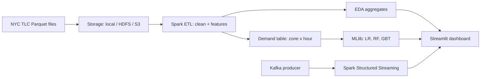

# NYC Taxi Trip Analytics and Demand Prediction (Apache Spark)

A big data analysis project that processes a full year of NYC yellow taxi trips (30M+ rows) with **PySpark**, finds demand patterns, and predicts **hourly pickups per taxi zone** with **Spark MLlib**. It also benchmarks Spark against Pandas, includes an optional **Kafka + Structured Streaming** demo, and ships a **Streamlit dashboard**.

## Architecture



## Big data characteristics (5 Vs)

| V | In this project |
|---|---|
| Volume | 30M+ trips per year in Parquet |
| Velocity | Kafka replay and windowed streaming aggregation |
| Variety | Trip tables, zone lookup, calendar and holiday data |
| Veracity | Invalid fares, distances and timestamps removed and counted |
| Value | Hourly demand forecasts for fleet positioning |

## Project structure

```
.
├── run_pipeline.py          # end-to-end batch pipeline
├── scripts/download_data.py # fetch TLC data
├── src/
│   ├── config.py            # paths, thresholds, study period
│   ├── clean.py             # ingestion + cleaning with rule-by-rule report
│   ├── features.py          # trip features, zone x hour demand table, lags
│   ├── eda.py               # analysis outputs (CSV)
│   ├── model.py             # LR / Random Forest / GBT, time-based split
│   ├── benchmark.py         # Pandas vs Spark runtime
│   └── streaming/           # Kafka producer + Spark Structured Streaming
├── dashboard/app.py         # Streamlit dashboard
├── tests/                   # pytest
├── docs/                    # report and architecture notes
└── outputs/                 # generated CSVs (created when you run the pipeline)
```

## Quick start

Requirements: Python 3.10+, Java 11 or 17 (needed by Spark).

```bash
git clone https://github.com/<your-username>/nyc-taxi-bigdata.git
cd nyc-taxi-bigdata
python -m venv .venv && source .venv/bin/activate      # Windows: .venv\Scripts\activate
pip install -r requirements.txt

# 1. Download data (start small: MONTHS=1,2,3)
MONTHS=1,2,3 python scripts/download_data.py

# 2. Run the pipeline
MONTHS=1,2,3 python run_pipeline.py            # add --skip-models for a fast first run

# 3. Open the dashboard
streamlit run dashboard/app.py

# Optional
python -m src.benchmark                         # Pandas vs Spark runtimes
pytest                                          # unit tests
```

On Windows PowerShell set variables like `$env:MONTHS="1,2,3"` before the command.

Note: a 60-day test window needs enough data. With only 1 to 2 months, set `TEST_DAYS=10`.

## Running on a cluster (HDFS or S3)

```bash
DATA_DIR=hdfs:///data/nyc_taxi spark-submit run_pipeline.py
# or  DATA_DIR=s3a://my-bucket/nyc_taxi  (with hadoop-aws on the classpath)
```

## Streaming demo (optional)

1. Start Kafka and create topic `taxi-trips`.
2. Start the consumer:
   `spark-submit --packages org.apache.spark:spark-sql-kafka-0-10_2.12:3.5.1 src/streaming/consumer.py`
3. Start the producer: `python -m src.streaming.producer --rate 200`

Use the Kafka connector version that matches your Spark and Scala versions.

## Method summary

1. **Clean**: drop nulls, bad timestamps, zero or extreme distances and fares, invalid passenger counts, duplicates; every rule's impact is saved to `outputs/cleaning_report.csv`.
2. **Features**: hour, weekday, month, weekend and US holiday flags, duration, speed, tip %, airport flag; zone x hour demand with 1h, 24h and 168h lags and rolling means.
3. **Models**: Linear Regression baseline, Random Forest, Gradient Boosted Trees; evaluated with RMSE, MAE and R2 on a chronological hold-out (no random shuffle, to avoid leakage).
4. **Dashboard**: weekday x hour heatmap, zone rankings, fare and tip analysis, model comparison, actual vs predicted.

## Results

Run the pipeline and paste your numbers here (see `outputs/model_results.csv`).

| Model | RMSE | MAE | R2 | Train time (s) |
|---|---|---|---|---|
| Linear Regression | | | | |
| Random Forest | | | | |
| Gradient Boosted Trees | | | | |

## Data source

NYC Taxi and Limousine Commission Trip Record Data (public). Check the TLC website for current file locations and schema notes.

## License

MIT
